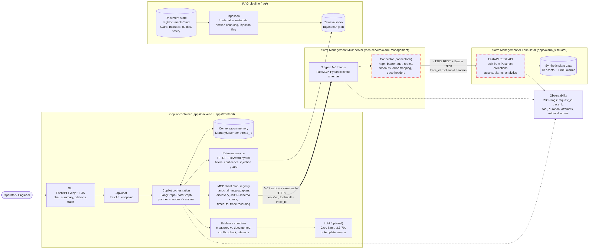

# Alarm Investigation and Procedure Guidance Copilot (MCP + RAG)

A copilot that helps operators and reliability engineers **investigate industrial alarms**.
It combines **live alarm data** (pulled through a self-built **MCP server** that wraps the Alarm Management API)
with **operating procedures and manuals** (found through **document RAG**), and returns a grounded answer
with citations and a full MCP execution trace.

> Selected use case: **Alarm Investigation and Procedure Guidance Copilot**
> (from the Senior Software Engineer - Copilot Integration assignment package).

---

## Contents

1. [Main capabilities](#main-capabilities)
2. [Technology stack](#technology-stack)
3. [Repository structure](#repository-structure)
4. [Quick start](#quick-start)
5. [Configuration](#configuration)
6. [MCP server](#mcp-server)
7. [RAG corpus and ingestion](#rag-corpus-and-ingestion)
8. [Tests and Postman](#tests-and-postman)
9. [Sample interactions](#sample-interactions)
10. [Architecture summary](#architecture-summary)
11. [Assumptions](#assumptions)
12. [Known limitations](#known-limitations)

---

## Main capabilities

- **Natural-language questions** such as *"Investigate recurring high-severity alarms for Boiler Feed Pump 101 over the last 90 days"*.
- **Intent detection + planning** (7 intents: investigation, recurring causes, active alarms, highest priority, related assets, procedure, consistency check).
- **MCP tool discovery** (`tools/list`) and **schema-aware invocation** (arguments checked against each tool's JSON schema before the call).
- **Multi-step chaining**: asset name -> `search_assets` -> asset id -> `get_alarms` -> alarm id -> `score_alarm_priority` / `get_operator_recommendations` -> asset type -> document filters.
- **Document RAG** over SOPs, maintenance manuals, troubleshooting guides and safety instructions with **citations** `[D1]`, metadata filters, low-confidence handling and **prompt-injection protection**.
- **Combined reasoning**: *measured* evidence (API, cited `[T6]`) vs *documented* guidance (RAG, cited `[D2]`); every API recommendation is checked against the documents and marked **supported / conflict / not in documents**.
- **Failure handling**: retries with back-off, timeouts, error mapping, unavailable tools, invalid inputs, partial failures and an MCP-server-down degraded mode - all visible in the GUI.
- **Context retention** per conversation (*"Which procedure applies to this alarm?"* reuses the previous asset/alarm).
- **GUI**: chat, alarm summary panel, likely causes and recommendations, citations, expandable MCP trace with raw request/response, tool-discovery view with schemas, error/retry notes, JSON/Markdown export, responsive layout.

## Technology stack

| Layer | Technology |
|---|---|
| GUI | FastAPI + Jinja2 template + plain JavaScript/CSS |
| Copilot backend | FastAPI, **LangGraph** `StateGraph` with `MemorySaver` checkpointer |
| MCP client | `langchain-mcp-adapters` `MultiServerMCPClient` (stdio or streamable HTTP) + `jsonschema` |
| MCP server | `mcp` **FastMCP** with Pydantic input/output models |
| Source system | Alarm Management API **simulator** (FastAPI) built from the Postman collections |
| Connector | `httpx` async client (auth, retries, timeouts, trace headers, error mapping) |
| RAG | Markdown corpus, section chunking, **TF-IDF (1-2 grams) + keyword hybrid** retrieval (scikit-learn) |
| LLM (optional) | Groq `llama-3.3-70b-versatile` via `langchain-groq`; falls back to a deterministic template answer |
| Tests | pytest, pytest-asyncio, pytest-cov, Postman/newman |
| Quality | ruff (format, lint, bugbear + bandit rules), GitHub Actions |
| Packaging | Dockerfile + docker compose (3 services with health checks) |

## Repository structure

```text
.
├── README.md
├── docs/                      architecture, diagram, MCP tool catalog, RAG design, API integration,
│                              design decisions, known limitations, code walkthrough, test evidence
├── apps/
│   ├── alarm_simulator/       Alarm Management API simulator (the source system)
│   ├── backend/               copilot: FastAPI app, LangGraph workflow, planner, MCP client, answer builder
│   └── frontend/              GUI (templates/index.html, static/script.js, static/style.css)
├── mcp-servers/
│   └── alarm-management/      the MCP server (alarm_mcp_server.py) + typed output schemas
├── connectors/                HTTP connector used by the MCP server (alarm_api_client.py)
├── rag/
│   ├── documents/             sample corpus (9 documents)
│   ├── ingestion/             ingest.py - load, chunk, flag, build index
│   ├── retrieval/             retriever.py - filtered hybrid search + citations
│   ├── safety.py              prompt-injection detection/sanitising
│   ├── index/                 generated index (git-ignored)
│   └── tests/                 RAG tests
├── tests/{unit,integration,e2e}
├── postman/                   reference collections + my contract-test collection
├── test-data/                 sample questions
├── scripts/                   run_local.sh, run_postman.sh, demo_failure.sh, generate_tool_catalog.py
├── .github/workflows/ci.yml
├── .env.example  .gitignore  Dockerfile  docker-compose.yml  Makefile  LICENSE  pyproject.toml
```

`optional-secondary-server/` from the suggested structure is not needed for this use case (one MCP server covers it).

## Quick start

### Option A - Docker (everything in one command)

```bash
cp .env.example .env            # optional: add GROQ_API_KEY for LLM-written answers
docker compose up --build
```

| Service | URL |
|---|---|
| GUI / copilot | http://localhost:8080 |
| Alarm API simulator | http://localhost:8000 (Swagger at `/docs`) |
| MCP server (streamable HTTP) | http://localhost:9000/mcp (health: `/health`) |

### Option B - Local Python (no Docker)

What you need on your machine:

- Python 3.11 or newer (`python3 --version`)
- pip and internet access for the first install
- Ports 8000 (Alarm API) and 8080 (GUI + backend) free
- Optional: a Groq API key in `.env` for LLM-written answers (without it the template answer is used)
- Optional: Node.js + `npm i -g newman` to run the Postman collections from the terminal

The frontend is served by the same FastAPI app as the backend, so there is no separate frontend server or `npm install`.
The MCP server is started automatically by the backend (stdio), so locally you only run two processes.

```bash
python -m venv .venv
source .venv/bin/activate              # Windows: .venv\Scripts\activate
pip install -r requirements-dev.txt
cp .env.example .env                   # Windows: copy .env.example .env

python -m rag.ingestion.ingest         # build the document index

# terminal 1 - the source system
uvicorn apps.alarm_simulator.main:app --port 8000

# terminal 2 - the copilot (it starts the MCP server itself over stdio)
uvicorn apps.backend.app:app --port 8080
```

Open http://127.0.0.1:8080 and click **Acceptance scenario**.

### Build and run commands (Makefile)

```bash
make install     # pip install -r requirements-dev.txt
make ingest      # build RAG index
make simulator   # Alarm API on :8000
make mcp-server  # MCP server alone (stdio)
make mcp-server-http   # MCP server alone on http://localhost:9000/mcp
make copilot     # GUI + backend on :8080
make test        # all tests
make coverage    # tests + coverage report (htmlcov/)
make lint        # ruff format check + lint
make postman     # run all Postman collections with newman
make up          # docker compose up --build
```

## Configuration

All configuration is through environment variables (see [`.env.example`](.env.example)). Secrets are never committed.

| Variable | Default | Used by | Meaning |
|---|---|---|---|
| `ALARM_API_BASE_URL` | `http://localhost:8000` | MCP server | Alarm API address |
| `ALARM_API_TOKEN` | `demo-token` | simulator + MCP server | Bearer token (Postman uses `demo-token`) |
| `ALARM_API_TIMEOUT_SECONDS` | `10` | MCP server | timeout per HTTP attempt |
| `ALARM_API_MAX_RETRIES` | `2` | MCP server | retries for 429/5xx/timeouts |
| `MCP_SERVER_URL` | empty | copilot | empty = start MCP server over stdio; set = use HTTP (e.g. `http://alarm-mcp:9000`) |
| `MCP_TRANSPORT` / `MCP_HOST` / `MCP_PORT` | `stdio` / `127.0.0.1` / `9000` | MCP server | transport settings |
| `MCP_TOOL_TIMEOUT_SECONDS` | `30` | copilot | overall timeout per tool call |
| `MCP_DISABLED_TOOLS` | empty | MCP server | hide tools (demo "tool unavailable") |
| `LLM_PROVIDER` / `GROQ_API_KEY` / `LLM_MODEL` | `groq` / - / `llama-3.3-70b-versatile` | copilot | LLM answer; `none` or no key = template answer |
| `DOCUMENT_PATH` / `RAG_INDEX_PATH` / `RAG_MIN_SCORE` | `rag/documents` / `rag/index/alarm_docs_index.json` / `0.12` | RAG | corpus, index, confidence threshold |
| `SIM_FAILURE_RATE` / `SIM_LATENCY_MS` | `0` | simulator | inject failures/latency for demos |

## MCP server

`mcp-servers/alarm-management/alarm_mcp_server.py` is a **FastMCP** server that exposes the Alarm Management API as **9 typed tools**.
The copilot never calls the Alarm API directly - only through these tools.

| Tool | API operation | Purpose |
|---|---|---|
| `search_assets` | `GET /assets/search` | asset name -> asset id |
| `get_asset_metadata` | `GET /assets/{id}/metadata` | criticality, limits, related assets |
| `get_alarms` | `GET /alarms` (+ pagination) | active / historical alarms |
| `get_alarm_details` | `GET /alarms/{id}` | one alarm |
| `get_alarm_summary` | `POST /alarms/summary` | counts, recurring rate, ack delay |
| `get_alarm_trends` | `POST /alarms/trends` | weekly/daily trend + direction |
| `correlate_alarms` | `POST /alarms/correlation` | alarms that occur together -> likely causes |
| `score_alarm_priority` | `POST /alarms/priority-score` | 0-100 score, P1-P4, explanation |
| `get_operator_recommendations` | `POST /recommendations/operator-actions` | recommended actions + related assets |

Full schemas, error/timeout behaviour and live examples: **[docs/mcp-tool-catalog.md](docs/mcp-tool-catalog.md)**.

**Start the MCP server on its own**

```bash
# stdio (for MCP clients such as MCP Inspector)
python mcp-servers/alarm-management/alarm_mcp_server.py

# streamable HTTP on http://localhost:9000/mcp
MCP_TRANSPORT=streamable-http python mcp-servers/alarm-management/alarm_mcp_server.py

# inspect it interactively
npx @modelcontextprotocol/inspector python mcp-servers/alarm-management/alarm_mcp_server.py
```

The server needs `ALARM_API_BASE_URL` and `ALARM_API_TOKEN` (the simulator must be running).

## RAG corpus and ingestion

`rag/documents/` holds 9 synthetic documents with YAML-style front matter (doc_id, title, doc_type, equipment_types, applies_to, version):
2 operating procedures (boiler feed pump, motor trip), 1 boiler/flood procedure, 2 maintenance manuals, 2 troubleshooting guides,
1 safety instruction and 1 *external vendor bulletin that contains a prompt-injection attempt* (to prove the guard works).

```bash
python -m rag.ingestion.ingest     # -> rag/index/alarm_docs_index.json (35 chunks)
```

Ingestion = read files -> parse metadata -> split by `##` section (long sections split by paragraph with overlap) -> flag injection text -> save JSON index.
Retrieval = metadata filters (equipment type / doc type) -> TF-IDF cosine + keyword-overlap hybrid score -> confidence check -> strip injected sentences -> citations.
Details: **[docs/rag-design.md](docs/rag-design.md)**.

## Tests and Postman

```bash
pytest -q                     # 124 tests: unit, MCP server, MCP client, RAG, orchestration, API client, e2e
pytest -q --cov               # coverage (93% at the time of writing)
bash scripts/run_postman.sh   # all Postman collections against a running simulator (needs: npm i -g newman)
```

| Suite | File(s) | What it proves |
|---|---|---|
| Unit | `tests/unit/` | planner/tool selection, payloads, citation formatting, conflict detection, simulator logic, MCP toolbox error paths |
| API client | `tests/integration/test_api_client.py` | auth + trace headers, retries, timeouts, error mapping, pagination, no token leakage |
| MCP server | `tests/integration/test_mcp_server.py` | tool registration/discovery, schemas, validation, error mapping, retries, trace propagation |
| MCP client | `tests/integration/test_mcp_client_integration.py` | real stdio connection, discovery, chaining, invalid args, missing tool, partial failure |
| RAG | `rag/tests/test_rag.py` | ingestion, chunking, metadata, relevance, filters, citations, no-result, injection |
| End-to-end | `tests/e2e/test_copilot_e2e.py` | HTTP request -> LangGraph -> real MCP server -> simulator -> RAG -> grounded answer with citations |

Evidence: [`docs/test-evidence/`](docs/test-evidence) (pytest + coverage output, newman results for all 4 collections).
The 3 reference Postman collections (`Simulator`, `Scenarios`, `Chaining` - 62 requests) and the contract collection (12 requests, 23 assertions) all pass.
To use the Postman app instead: import the files in `postman/` plus `postman/local.postman_environment.json` and run the collections.

## Sample interactions

| Question | What happens |
|---|---|
| *Investigate recurring high-severity alarms for Boiler Feed Pump 101 over the last 90 days, identify likely contributing factors, retrieve the relevant operating procedure, and provide recommended actions with source evidence.* | 9 MCP steps. *High Discharge Pressure* is the most frequent alarm and gets a P1 priority; correlation shows *FCV-101 Valve Position Deviation* precedes it in ~76% of cases; cites SOP-BFP-001, MM-PMP-002 and TG-VLV-006; flags the API suggestion "reset the trip and restart the pump" as **conflicting** with the SOP restart rule. |
| *What related assets should be inspected for this alarm?* (follow-up) | Reuses Boiler Feed Pump 101 from context; lists BFP Motor 101, FCV-101, Deaerator D-101 with reasons. |
| *Which alarm has the highest priority in EastRefinery, and why?* | Fetches active site alarms, scores each, picks the K-501 High Discharge Pressure alarm (P1) and explains the factors. |
| *Why are compressor discharge pressure alarms repeatedly occurring?* | Resolves "compressor" to 3 assets, focuses on K-501, correlation shows Discharge Cooler E-501 high outlet temperature first; cites TG-CMP-003 (cooler fouling). |
| *What related assets should be inspected for this motor trip alarm?* | Focuses on Compressor Motor M-501; Lube Oil Pump LOP-501 low pressure precedes trips; SOP-MTR-004 cited. |
| *Investigate Pump XYZ 999* | No exact asset match -> asks for clarification and shows the closest assets. |

More questions: [`test-data/sample_questions.json`](test-data/sample_questions.json).

## Architecture summary



GUI -> `/api/chat` -> **LangGraph** workflow (`plan -> discover_tools -> resolve_scope -> fetch_alarms -> analyze_alarms -> prioritize_and_recommend -> asset_context -> retrieve_documents -> compose_answer`).
All alarm data flows **GUI -> copilot -> MCP client -> MCP server -> connector -> Alarm API**. Documents flow **corpus -> ingestion -> index -> retriever -> evidence combiner**.
Both paths meet in `compose_answer`, which separates measured evidence, document guidance and generated text.
Full request flow, auth boundaries and observability: **[docs/architecture.md](docs/architecture.md)**.
Beginner-friendly code walkthrough: **[docs/CODE_EXPLANATION.md](docs/CODE_EXPLANATION.md)**.
Other docs: [api-integration.md](docs/api-integration.md) | [design-decisions.md](docs/design-decisions.md) | [known-limitations.md](docs/known-limitations.md).

## Assumptions

- The Postman collections are the contract; response bodies were not given, so the simulator's response shapes are my own design (documented in `docs/api-integration.md`).
- Plant data is synthetic and deterministic (seeded), starting 2026-04-01 up to "now", with a few built-in patterns (valve -> pump pressure, cooler -> compressor, lube oil -> motor trip, Unit 2 floods).
- "Last N days" is relative to the current UTC time; with no range given the copilot uses 90 days and says so.
- One shared API token is enough for a simulator; real deployments would use per-user OAuth (see limitations).
- An LLM is optional so the solution runs and is testable without any paid key.

## Known limitations

Short list (full list in [docs/known-limitations.md](docs/known-limitations.md)):
rule-based planner (not LLM tool-calling), TF-IDF instead of neural embeddings, heuristic conflict detection,
in-memory conversation store, synthetic data, single shared API token, English only.

## Failure testing

With the simulator running: `bash scripts/demo_failure.sh correlation` makes `/alarms/correlation` return 503,
`flaky` makes 30% of calls fail (retries usually recover), `reset` goes back to normal.
